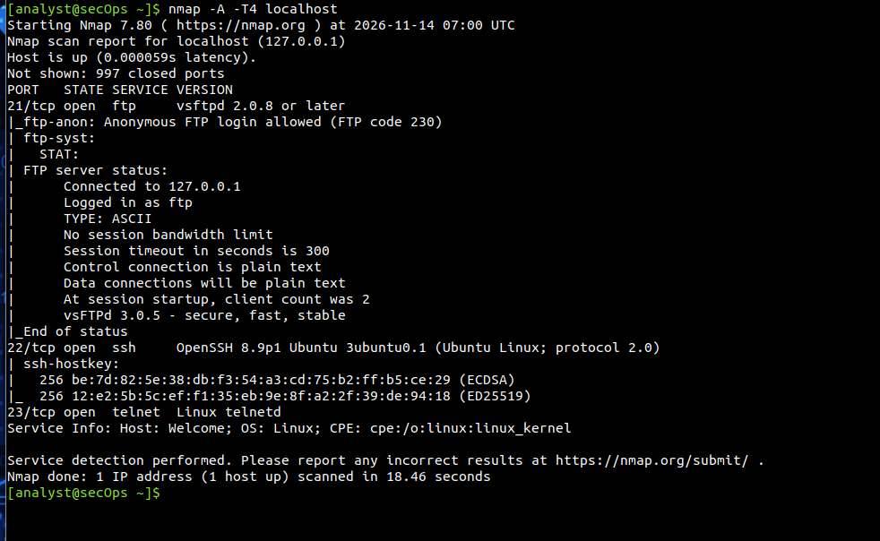
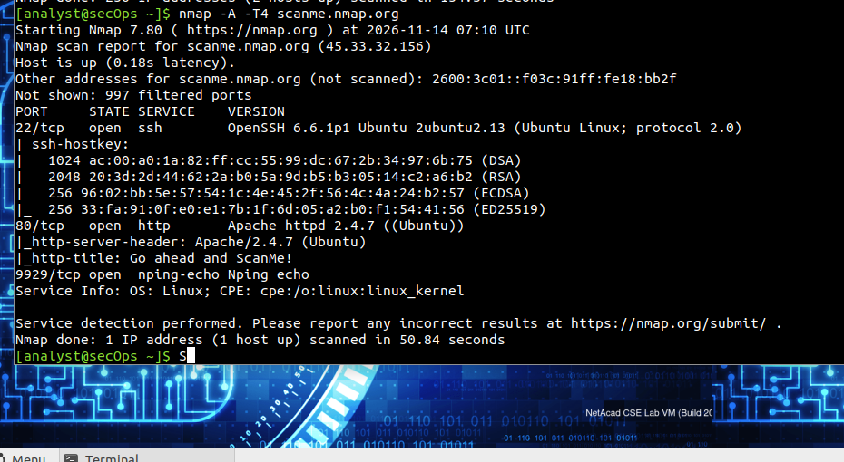

# Nmap Service Scan and Analysis

**Course:** WQE7001 Cyber Security  
**Lab:** Cisco Networking Academy — Lab 9.3.8, Exploring Nmap  
**Lab date:** 14 November 2026  
**Author:** Chen Zuyao

## Objective

This project documents an authorised Nmap exercise used to identify reachable hosts, TCP port states, and exposed network services. The work involved a local CyberOps workstation, its laboratory subnet, and the designated Nmap test server. The goal was to interpret the observed scan results accurately and recognise the limits of service detection.

## Environment and Tools

- **System:** Cisco CyberOps Workstation virtual machine running Linux.
- **Tool:** Nmap (Network Mapper), plus the Linux `ip` command.
- **Local target:** `localhost` (`127.0.0.1`).
- **Laboratory network:** `192.168.226.0/24`, with workstation IP `192.168.226.13` at the time of the lab.
- **Designated external test target:** `scanme.nmap.org`, scanned during the course lab within its published testing limits.

## Method — Step by Step

1. Opened a Linux terminal and reviewed the Nmap manual with `man nmap`.
2. Scanned the local workstation using `nmap -A -T4 localhost` to identify open ports and services.
3. Ran `ip a` to identify the workstation's address and the local subnet.
4. Scanned the authorised laboratory subnet using `nmap -A -T4 192.168.226.13/24`.
5. Scanned the designated Nmap test server using `nmap -A -T4 scanme.nmap.org`.
6. Recorded service banners, port states, and terminal evidence, then distinguished verified observations from uncertain service identification.

The `-A` option enables several advanced detection features, including service and operating-system detection. The `-T4` option selects a relatively fast timing template.

## Results and Evidence

### Evidence 1 — Localhost Scan

The local workstation scan found **three open TCP ports**, while 997 scanned ports were reported closed:

| Port | State | Service | Observed software |
| --- | --- | --- | --- |
| 21/tcp | open | FTP | vsftpd; server banner reported 3.0.5 |
| 22/tcp | open | SSH | OpenSSH 8.9p1 Ubuntu 3ubuntu0.1 |
| 23/tcp | open | Telnet | Linux telnetd |

*Figure 1. Actual terminal evidence of the localhost Nmap scan.*

### Laboratory Subnet Scan

The workstation was assigned `192.168.226.13/24`. The authorised subnet scan detected **two reachable hosts**: `192.168.226.2` (gateway) and `192.168.226.13` (workstation). The gateway showed `53/tcp` as `domain?`; Nmap did not reliably establish the service version. The workstation exposed the three services listed above.

### Evidence 2 — Designated Test Server Scan

The scan of `scanme.nmap.org` resolved the test server to `45.33.32.156` on the lab date and found the following ports open:

| Port | State | Service | Observed software |
| --- | --- | --- | --- |
| 22/tcp | open | SSH | OpenSSH 6.6.1p1 Ubuntu |
| 80/tcp | open | HTTP | Apache httpd 2.4.7 (Ubuntu) |
| 9929/tcp | open | Nping echo | Nping echo |

The output also stated that **997 ports were filtered**. Their individual numbers and services were not listed, so they cannot be identified from this evidence.

*Figure 2. Actual terminal evidence of the designated Nmap test server scan.*

## Security Analysis

Nmap is useful for identifying exposed services and supporting asset inventories. In the local exercise, the presence of FTP and Telnet provides a reason to review whether those services are necessary and suitably protected. An open port alone is **not proof of a vulnerability**; confirming risk requires additional authorised assessment and context.

## Reflection and Improvements

The exercise highlighted the need to avoid treating tentative service labels as confirmed findings. For example, the gateway's `domain?` result did not establish an exact service or software version. Similarly, a summary of 997 filtered ports did not identify which individual ports were filtered. In future work, I would record the Nmap version, save machine-readable scan output, repeat scans under consistent conditions, and explain the uncertainty of each conclusion.

## Authorisation and Safety

The localhost and laboratory network were part of an authorised learning environment. The external scan used the designated Nmap test host for the course exercise, subject to the host's published permissions. This portfolio does not authorise scanning unrelated systems.
