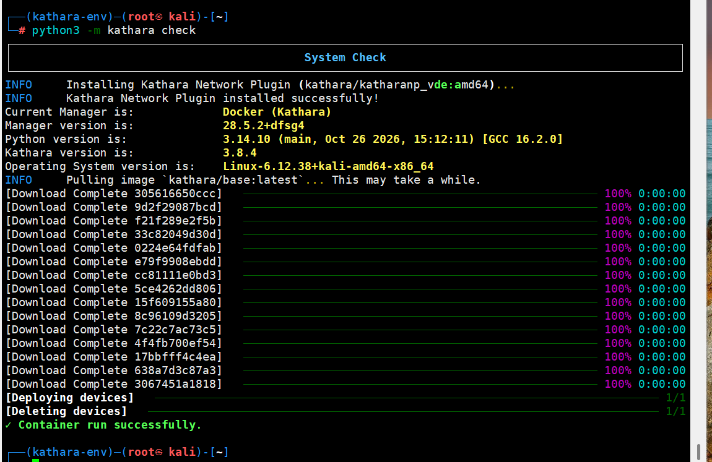
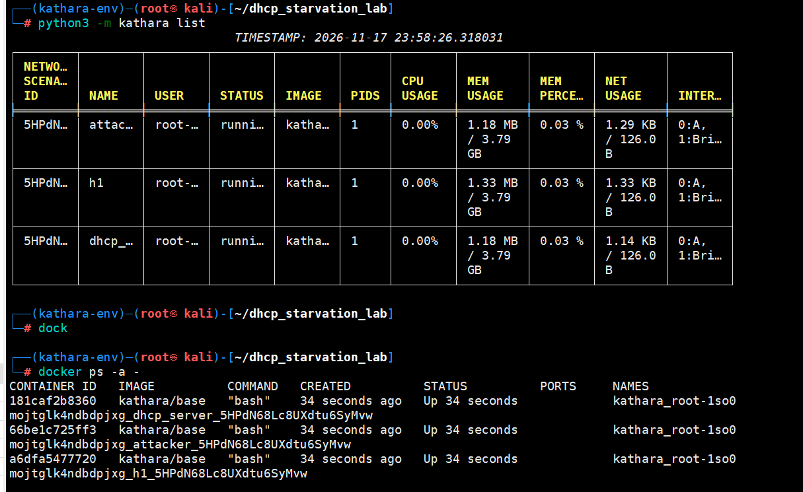
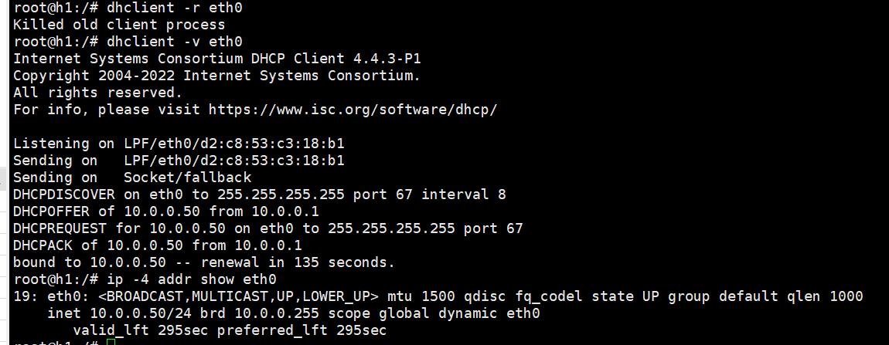
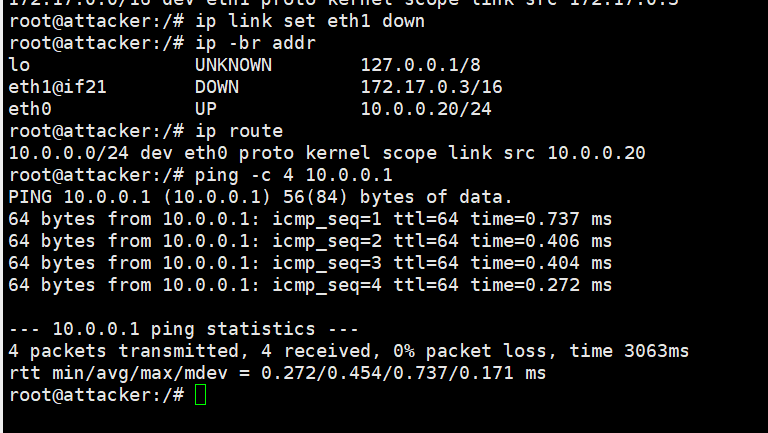

# Project 1 — Virtual Cybersecurity Lab Setup

**Coursework environment:** Kali Linux, Kathará and Docker  
**Lab context:** Authorised DHCP and virtual networking exercises  
**Evidence date:** 17 November 2026

## Objective

The objective of this project was to prepare and verify a controlled virtual networking laboratory for cybersecurity practice. I focused on confirming that the lab containers were running, checking network interface settings, obtaining an address from the lab DHCP server, and testing connectivity within the lab. The evidence below documents environment setup and verification; it does not, by itself, demonstrate a successful DHCP starvation attack.

## Environment and Tools

- **Host operating environment:** Kali Linux.
- **Virtual lab orchestration:** Kathará using Docker containers.
- **Lab nodes:** `attacker`, `h1` and `dhcp_server`.
- **Lab network:** The relevant interfaces used the `10.0.0.0/24` subnet in the recorded checks.
- **Utilities:** `python3 -m kathara`, `docker ps`, `dhclient`, `ip` and `ping`.
- **Scope:** A locally controlled coursework lab, not unrelated external systems.

## Method — Step by Step

1. **Checked Kathará installation.** In the configured Python environment, I ran `python3 -m kathara check`. The output identified Docker as the container manager and reported that the container check completed successfully.
2. **Confirmed the virtual lab nodes.** I inspected running nodes with `python3 -m kathara list` and checked their Docker containers. The output showed the `attacker`, `h1` and `dhcp_server` nodes running.
3. **Verified DHCP address allocation.** On the lab host `h1`, I released the previous lease with `dhclient -r eth0`, then requested an address using `dhclient -v eth0`. The output showed a DHCP offer and acknowledgement for `10.0.0.50` from `10.0.0.1`.
4. **Checked the assigned address.** I ran `ip -4 addr show eth0` on `h1`, confirming `10.0.0.50/24` on the `eth0` interface.
5. **Inspected another node's network interfaces.** On `attacker`, the `ip -br addr` output showed `eth0` up with address `10.0.0.20/24`, while `eth1` was down. The route output included the connected `10.0.0.0/24` network.
6. **Tested local connectivity.** From `attacker`, I ran `ping -c 4 10.0.0.1`. All four replies were received, with 0% packet loss.

## Results and Evidence

### Evidence 1 — Kathará Environment Check

The environment check showed a working Kathará installation with Docker as the manager. The final output reported **“Container run successfully.”**

*Figure 1. Kathará system check in Kali Linux.*

### Evidence 2 — Running Virtual Lab Nodes

The Kathará and Docker listings showed three running lab nodes: `attacker`, `h1`, and `dhcp_server`.

*Figure 2. Virtual lab containers listed in Kathará and Docker.*

### Evidence 3 — DHCP Address Assignment

The DHCP client on `h1` received address **`10.0.0.50`** from the lab DHCP server **`10.0.0.1`**. The `ip` command also confirmed `10.0.0.50/24` on `eth0`.

*Figure 3. DHCP offer, acknowledgement and assigned client address.*

### Evidence 4 — Network Connectivity Verification

The `attacker` node had **`10.0.0.20/24`** on `eth0`. A ping to **`10.0.0.1`** returned **4 replies from 4 transmitted packets**, with **0% packet loss**.

*Figure 4. Interface status, routing and successful local ping test.*

## Reflection and Improvements

This exercise reinforced the importance of checking the lab environment before drawing conclusions from network tests. During setup, an earlier attempt to run Kathará outside the configured Python environment returned **`No module named kathara`**. Using the configured `kathara-env` and then verifying the installation with `python3 -m kathara check` helped resolve that environment issue. I also learned to distinguish successful DHCP address allocation from general reachability: the DHCP output demonstrated an address lease, while the ping output separately verified connectivity to the lab endpoint.

For future labs, I would record the network topology and software versions alongside the screenshots, keep setup and teardown commands in a repeatable lab guide, and capture verification output for each lab node. These steps would make the exercise easier to reproduce and review.

## Authorisation and Safety

This project documents a controlled educational environment. The screenshots are presented as evidence of virtual lab setup, DHCP address allocation and connectivity testing. They do **not** establish that a denial-of-service attack succeeded. No testing of unrelated third-party systems is included.
